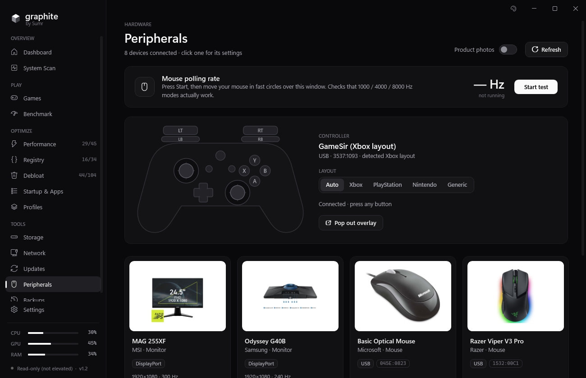
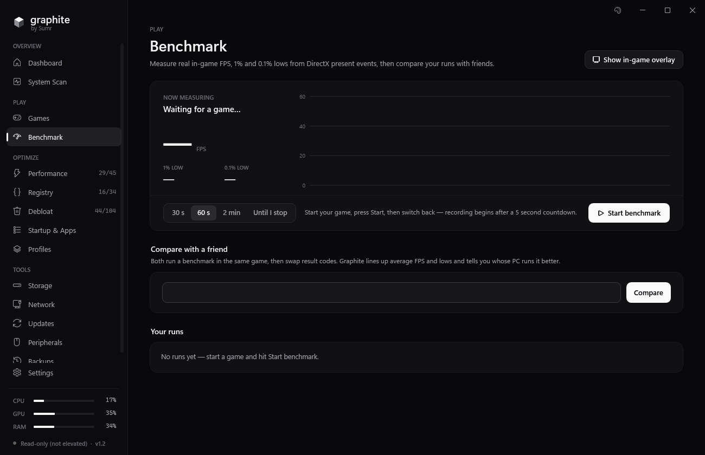
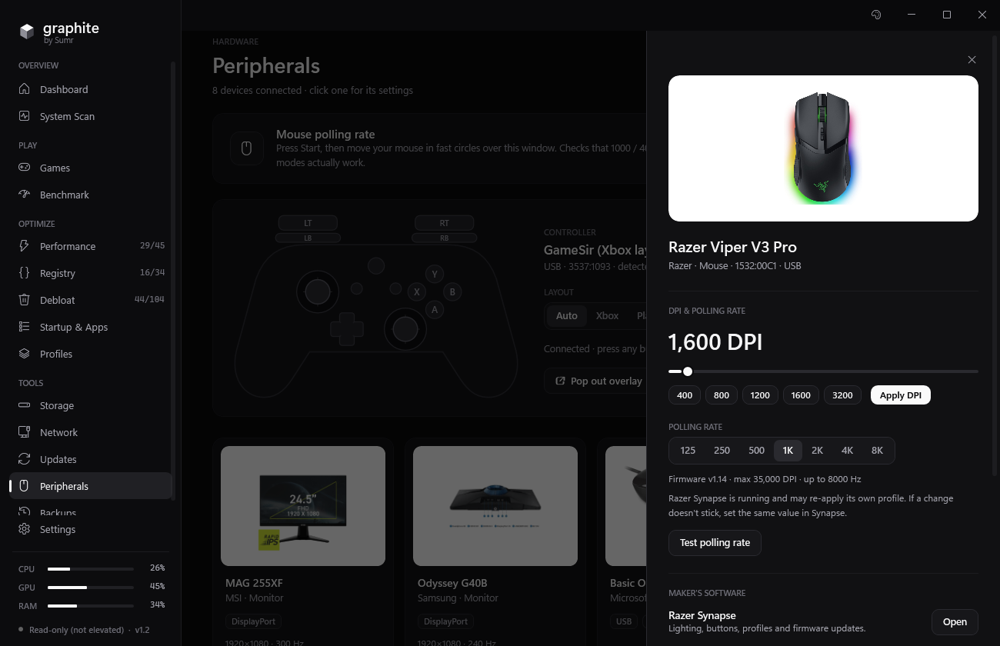

# graphite

**A lightweight, ad-free PC optimizer for gaming — by Sumr.**

No ads, no accounts, no telemetry. One small app for Windows 10 and 11 that tunes your PC for FPS and latency, cleans out bloat, and backs up every change it makes so anything can be undone.

## Install

Open **PowerShell** (Start → type `powershell` → Enter) and paste:

```powershell
irm https://raw.githubusercontent.com/sumrzao/graphite/main/install.ps1 | iex
```

That's it. Graphite installs to `%LOCALAPPDATA%\Graphite\app`, adds itself to the Start menu and opens (accept the administrator prompt — it needs admin rights to change system settings). Run the same line again any time to update.

Prefer a manual download? Grab `Graphite-win-x64.zip` from [Releases](../../releases/latest), unzip, run `Graphite.exe`.



## What it does

| | |
|---|---|
| **Performance** | 45 FPS & input-latency tweaks, picked for your exact CPU and GPU (Ryzen, Radeon, GeForce, Intel hybrid) |
| **Registry & Debloat** | 138 more: responsiveness, telemetry, ads, Copilot / Recall / Widgets, services, preinstalled apps |
| **Games + Game Boost** | Finds Steam, Epic and Riot games; launching one raises its priority, frees RAM, holds a 0.5 ms timer and quiets background apps — then restores everything when you quit. Per-game CPU rules too |
| **Benchmark** | Real FPS, 1% and 0.1% lows from DirectX present events. Share a result code and compare with a friend |
| **In-game overlay** | `Ctrl+Shift+F`: FPS, 1% low, GPU temp/load, CPU load (borderless / windowed games) |
| **Peripherals** | Every connected device with a product photo. Change DPI and polling rate on Razer mice, test polling rate, live controller overlay (Xbox / PlayStation / Nintendo) |
| **System Scan** | Full spec sheet + health checks: XMP, dual channel, refresh rate, Resizable BAR, drivers |
| **Storage** | What's filling your drives, largest folders and files, one-click cleanup |
| **Network** | Ping, jitter, loss, latency to game-server regions, DNS benchmark and switch |
| **Updates** | Graphics driver check, pause Windows Update, active hours, no surprise restarts |
| **Startup & Apps** | Startup apps on/off, heavy background apps, fresh-PC app installer (winget) |
| **Profiles** | Balanced / Competitive / Streaming presets, share your setup as a code |



## Safe by design

- Every value is **backed up before it's changed** and restored exactly on revert (Backups page).
- A **System Restore point** is created before the first change.
- Each tweak shows a risk level and a *What it changes* list of the exact registry values, services or commands.
- Graphite never disables Windows Update, Defender or your drivers.



## Requirements

64-bit Windows 10 (1809+) or Windows 11. Uses the .NET Framework 4.8 that's already built into Windows — nothing else to install.

## Uninstall

Revert anything you want from **Backups**, turn off *Start with Windows* in Settings, then delete `%LOCALAPPDATA%\Graphite` and the Start menu shortcut.

---

<sub>Graphite by Sumr · more screenshots in [/screenshots](screenshots)</sub>
